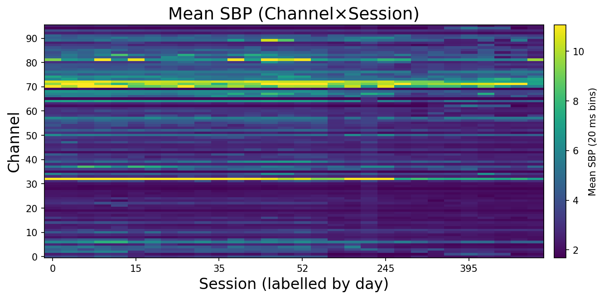
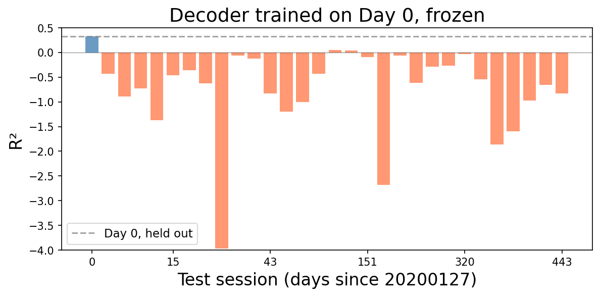
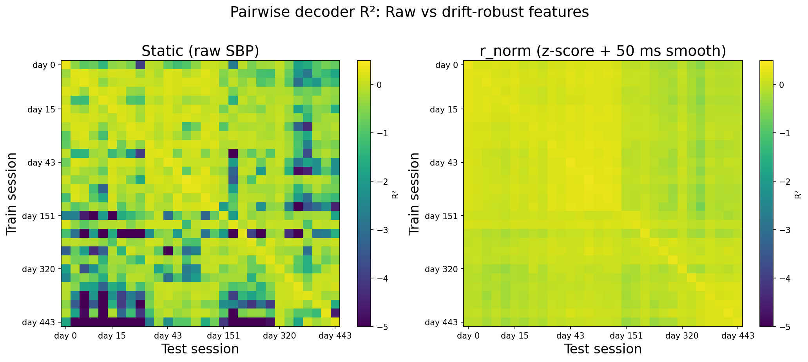
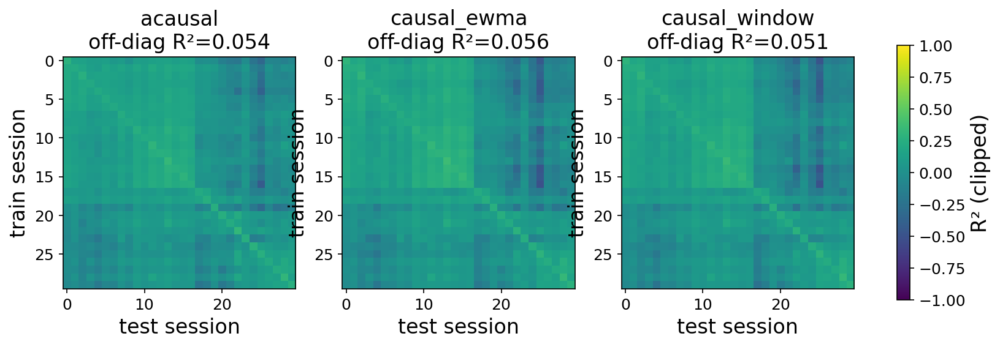

# ephys-signal

A Python analysis package for drift-robust feature engineering from chronic extracellular electrophysiology recordings.


> **Latest result ([scoreboard](results/SCOREBOARD.md), commit `2edeafd`):** a frozen decoder on causal (online) per-session normalization keeps at least half of its held-out same-day R² for **52 days (95 % CI 26–84)**; on raw SBP, for 0 days (CI 0–9). Beyond a month the median pair keeps nothing. Short gaps come mostly from Jan–Mar 2020, so gap and recording period are partly confounded. Lab note: [2026-W43](results/notes/2026-W43.md).

Every number on the [scoreboard](results/SCOREBOARD.md) is held out, from 3 seeds, with a 95 % CI and compute cost, and comes from one command (`python -m bench.run`, needs the LINK sessions in `01_data/`). Numbers below marked *notebook* are single runs without a CI.

## What this is

This project builds a signal processing and decoding pipeline on the [LINK dataset](https://dandiarchive.org/dandiset/001201) (DANDI:001201): spiking-band power (SBP), threshold-crossing rates (TCR) and finger kinematics from 96 Utah-array channels in macaque motor cortex. The central question is how to engineer features that remain stable for population decoding despite long-term electrode drift and channel dropout.

**Scope:** every result here comes from a local subset of **30 sessions, 2020-01-27 → 2021-04-14 (443 days)**, not the full dataset (312 sessions over 1,242 days).

The pipeline follows a medallion architecture (Bronze → Silver → Gold):

- **Bronze** — raw NWB session loading
- **Silver** — filtering, artefact removal, spike detection (stubs only: LINK ships no raw broadband, so this layer cannot run on it)
- **Gold** — drift-robust features (per-session z-score normalization, population rate smoothing, session QC), decoder training, and evaluation plots

## Results at a glance

### Long-term signal landscape

96-channel Utah-array SBP traces across the local subset of 30 LINK sessions reveal channel-specific dropout and slow drift.



### Decoder drift without correction

*Notebook (`sbp-drift-discovery_v1`):* a decoder trained on Day 0 scores R² 0.26 on held-out blocks of Day 0, then below zero on 27 of the 29 later sessions (lowest −3.27, on day 163).



### Per-session normalization

*Notebook (`sbp-drift-fix_v1`, no CI):* per-session normalization (`r_norm`) raises mean cross-session decoder R² from −0.151 to +0.055 (Δ +0.206). It holds over short gaps (1–7 days: 0.117) but not beyond a month (−0.0205).



### Causal streaming normalization

*Notebook (`sbp-causal-streaming_v1`, no CI):* the causal (online-ready) version matches the acausal mean cross-session R² after warm-up (0.0560 vs 0.0545). Scored including warm-up it was 0.0509, so nearly all of the earlier "cost of causality" was the per-session start-up transient. On the scoreboard, causal same-day R² is lower than acausal (0.183 vs 0.270) but keeps the same share of it across days.



## Structure

```text
01_data/          NWB session files (not tracked — download from DANDI)
02_package/       neurosignal Python package
  src/neurosignal/
    io/           NWB loaders and session inspection
    silver/       filters, artefact detection, spike detection (stubs)
    gold/         drift analysis, feature normalization, decoder training
    viz/          figure export utilities
03_notebooks/     Analysis notebooks (thin wrappers over the package)
04_output/        Generated figures and supporting outputs
bench/            Evaluation harness: frozen splits, one decoder spec, CFD with CI (python -m bench.run)
results/          Scoreboard (source: scoreboard.csv) and weekly lab notes
```

## Setup

Python 3.12+. From the repo root:

```bash
python -m venv venv
source venv/bin/activate
pip install -r requirements.txt
```

This installs `neurosignal` (editable) with the notebook and DANDI tools. For the package alone: `pip install -e 02_package`.

Data download ([DANDI CLI](https://github.com/dandi/dandi-cli), installed above):

```bash
dandi download DANDI:001201
```

## Notebooks

| Notebook | Description |
| --- | --- |
| `sbp-drift-discovery_v1.ipynb` | Channel dropout and TCR/SBP drift curves over 443 days (30 sessions) |
| `sbp-drift-fix_v1.ipynb` | Daily normalization and drift-corrected population rate |
| `sbp-mlp-decoder_v1.ipynb` | Cross-session MLP decoder using joint SBP + TCR features |
| `sbp-causal-streaming_v1.ipynb` | Causal (online) normalization for streaming cross-session decoding |

## Dataset

| | Full LINK dataset | Analysed here |
| --- | --- | --- |
| Sessions | 312, recorded on 303 days | 30 |
| Span | 1,242 days (~3.5 years) | 443 days (2020-01-27 → 2021-04-14) |
| Subject | one rhesus macaque, 96 Utah-array channels in M1 | same |
| Behaviour | self-paced two-finger task; index-finger flexion velocity (`index_velocity`) is the decoder target | same |

Temmar, H., Gill, N., Wang, Y., … Chestek, C. A. (2026). *LINK: Long-Term Intracortical Neural Activity and Kinematics* (Version 0.261015.2153) [Data set]. DANDI Archive. https://doi.org/10.48324/dandi.001201/0.261015.2153 — CC-BY-4.0. Associated paper: Temmar et al., NeurIPS 2025 ([OpenReview](https://openreview.net/forum?id=TAdeh1dLzu)).
