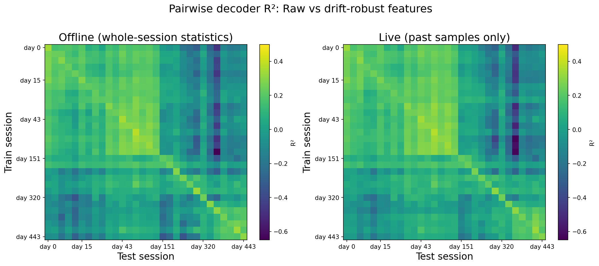

# Can the per-session normalisation run live, using only past samples, and what does that cost?

**Status:** Answered · decoder spec `v2` · commit `88513ad` · 2026-10-26

**Short answer: yes.** A version that only uses past samples (running mean and variance, α 0.01) passes the causality checks. Within a session, its decoder reaches a median R² of 0.263 against 0.276 offline: 95 % of the offline version's (95 % CI 90 % to 102 %). Across sessions it shows slightly better transfer between days: +0.019 (95 % CI +0.011 to +0.027). It keeps 24 bytes of state per channel, above the 16-byte target.

Details

| Quantity | Value |
| --- | --- |
| Causality: future-perturbation check, EWMA · window · offline | passes · passes · fails (expected) |
| Causality: batch output == sample-by-sample replay | passes |
| Same-day R², median over sessions, live (seeds) | 0.2630 (0.2638 · 0.2621 · 0.2630) |
| Same-day R², median over sessions, offline (seeds) | 0.2755 (0.2755 · 0.2743 · 0.2768) |
| Live ÷ offline, same day | 0.955 (95 % CI 0.903 to 1.022) |
| Mean cross-session R², offline | +0.030 (95 % CI −0.012 to +0.079) |
| Mean cross-session R², live EWMA | +0.049 (95 % CI +0.008 to +0.097) |
| Mean cross-session R², live trailing window (300 bins) | +0.048 (95 % CI +0.009 to +0.093) |
| Live EWMA − offline | +0.019 (95 % CI +0.011 to +0.027) |
| Trailing window − EWMA | −0.002 (95 % CI −0.005 to +0.002): the window makes no detectable difference |
| α sweep, Day-0 decoder mean R² on later sessions | 0.001: +0.0005 · 0.003: +0.0168 · 0.01: +0.0254 · 0.03: +0.0384 · 0.1: +0.0018 · 0.3: −0.0266 |
| α 0.01 − 0.003 · α 0.01 − 0.03 | +0.0087 (95 % CI +0.0062 to +0.0112) · −0.0130 (95 % CI −0.0258 to −0.0015) |
| State per channel (float64) | live 24 B (EWMA mean, variance, smoother); offline needs the whole session; target ≤ 16 B |

- **Data:** 30 LINK sessions, 2020-01-27 → 2021-04-14, index-finger velocity.
- **Features:** offline = each session z-scored with its own mean and SD, then a 50 ms Gaussian (sees the future); live = running mean and variance (α 0.01, a time constant of about 2 s) then a one-pole smoother (0.2), state reset every session; trailing window = z-score over the last 300 bins. The first 300 bins (6 s) of every session are never scored, for both.
- **Decoder:** ridge on the last 100 ms of features predicting velocity at the current bin (spec `v2`). Same day: 5 purged held-out blocks, seeds shift the block grid. Cross-session: fit on one whole session, score another.
- **Uncertainty:** 95 % CIs from 2,000 session-resampled draws (pooled over seeds for the same-day ratio). A difference counts only if its CI excludes zero.
- **α sweep:** one Day-0 decoder per α, so it is a cheap screen, not a selection; α 0.03 scores highest here. Selecting α properly (on early sessions, confirmed on later ones) and carrying state across sessions is the next step (streaming v2).
- **Limits:** one animal, one task; with α 0.01 the running statistics forget within seconds, so this is close to an adaptive high-pass filter rather than a slow drift tracker; state resets each session; ops per bin and fixed-point size are not yet counted.
- **Cost:** 1446 decoder fits, 737 s; the decoder costs 576 multiply-accumulates per 20 ms bin.

*Generated by `analyses/causal_norm.py` from `results/analyses/causal_norm.json`. Do not edit by hand.*
