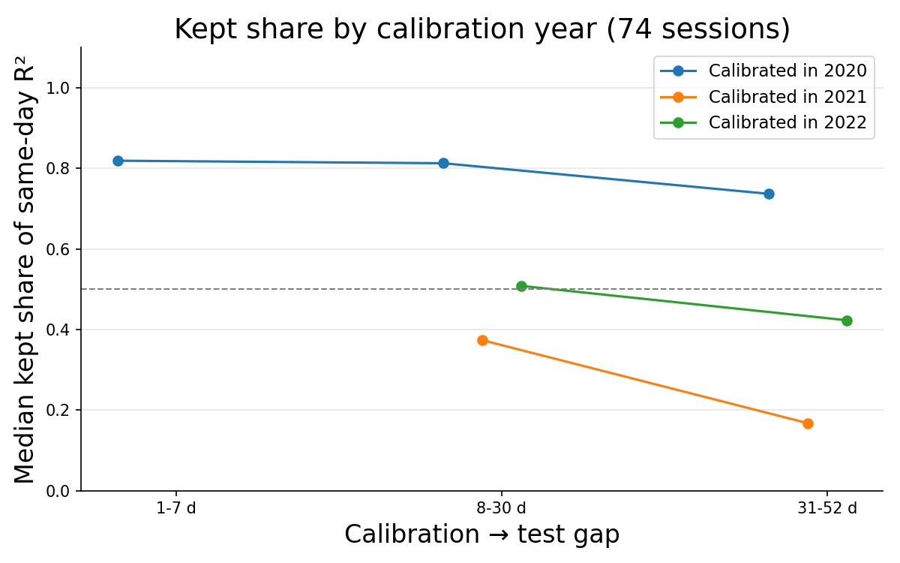

# Does calibration-free days measure the gap between sessions, or the recording period?

**Status:** Answered · splits `v1` (74 sessions, 2701 pairs) · bench commit `c480799` · decoder spec `v2` · 2026-11-08

**Reading (EXP-008): period effect.** On this split, causal CFD is 25 d (95 % CI 11–52), against 52 d on the 30-session split. Fitted on pairs calibrated in 2021–2023 only, it is 14 d (95 % CI 0–24, 1326 pairs).

**Causal `r_norm`: median kept share (pairs) by calibration year, and 2020 − 2021–2023**

| Gap | 2020 | 2021 | 2022 | 2023 | 2020 − 2021–2023 |
| --- | --- | --- | --- | --- | --- |
| 1-7 d | 0.82 (22) | too few | too few | too few | too few (22 vs 3 pairs) |
| 8-30 d | 0.81 (60) | 0.37 (45) | 0.51 (24) | too few | +0.39 (95 % CI +0.07 to +0.63) · period |
| 31-52 d | 0.74 (31) | 0.17 (39) | 0.42 (21) | too few | +0.42 (95 % CI +0.15 to +0.72) · period |

Details

**Raw SBP, same layout**

| Gap | 2020 | 2021 | 2022 | 2023 | 2020 − 2021–2023 |
| --- | --- | --- | --- | --- | --- |
| 1-7 d | 0.20 (22) | too few | too few | too few | too few (22 vs 3 pairs) |
| 8-30 d | 0.15 (60) | 0.00 (45) | 0.00 (24) | too few | +0.15 (95 % CI +0.00 to +0.56) · inconclusive |
| 31-52 d | 0.15 (31) | 0.00 (39) | 0.00 (21) | too few | +0.15 (95 % CI +0.00 to +0.59) · inconclusive |

**Target style (EXP-008 amendment 1, descriptive on this split: P8–P9 are stage 2 only): causal `r_norm`; sessions CO 39 · RD 35**

| Gap | 2020 − 2021–2023, same-style pairs | Same-style − cross-style, all years |
| --- | --- | --- |
| 1-7 d | too few (17 vs 1 pairs) | too few (18 vs 7 pairs) |
| 8-30 d | +0.20 (95 % CI −0.10 to +0.56) · inconclusive | −0.02 (95 % CI −0.39 to +0.34) |
| 31-52 d | too few (1 vs 41 pairs) | −0.14 (95 % CI −0.47 to +0.35) |

**EXP-008 predictions on this split**

| Prediction | Result |
| --- | --- |
| P1 causal CFD < 52 d | pass |
| P2 period effect at 8-30 d and 31-52 d | pass |
| P3 raw CFD ≤ 7 d | pass |
| P4 fixed-point and float CFD within 1 d | pass |

| CFD (d, 95 % CI, seed range) | raw SBP | causal `r_norm` | fixed-point causal |
| --- | --- | --- | --- |
| this split | 0 (0–6) | 25 (11–52, 25–25) | 25 (11–52) |

- **Kept share** of a pair = max(cross-day R², 0) ÷ the calibration session's held-out same-day R² (bench, D-12). Medians pool seeds 0, 1, 2; a cell needs ≥ 15 pairs.
- **Contrast CI:** 2,000 draws resampling sessions; a pair's weight is the draws of its calibration session × the draws of its test session. "period" = contrast ≥ +0.10 with a CI that excludes 0; "gap" = CI inside ±0.10; else "inconclusive" (EXP-008, fixed before running).
- **Limits:** the calibration year stands in for the recording period and cannot separate it from the implant's age. Target style (CO, RD) is read from the NWB identifier; the file does not say what the codes mean. One animal, one task.
- **Source:** `results/bench_v1_pairs.csv` and `results/scoreboard.csv` at commit `c480799`; this script fits no decoder.

