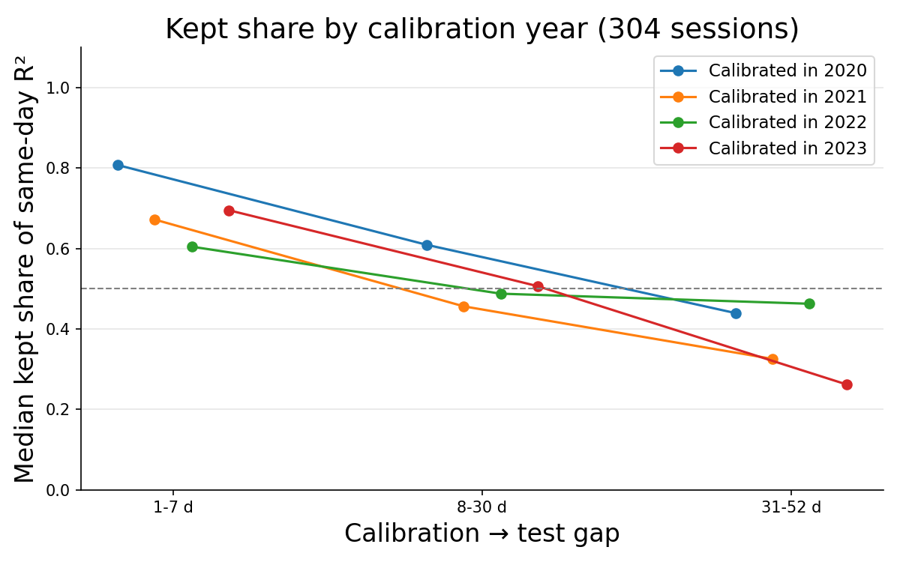

# Does calibration-free days measure the gap between sessions, or the recording period?

**Status:** Answered · splits `v2` (304 sessions, 46047 pairs) · bench commit `950ef06` · decoder spec `v2` · 2026-11-20

**Reading (EXP-008): inconclusive.** On this split, causal CFD is 14 d (95 % CI 9–20), against 52 d on the 30-session split. Fitted on pairs calibrated in 2021–2023 only, it is 14 d (95 % CI 8–18, 34707 pairs).

**Causal `r_norm`: median kept share (pairs) by calibration year, and 2020 − 2021–2023**

| Gap | 2020 | 2021 | 2022 | 2023 | 2020 − 2021–2023 |
| --- | --- | --- | --- | --- | --- |
| 1-7 d | 0.81 (42) | 0.67 (291) | 0.60 (283) | 0.70 (87) | +0.16 (95 % CI −0.05 to +0.23) · inconclusive |
| 8-30 d | 0.61 (132) | 0.46 (913) | 0.49 (801) | 0.51 (210) | +0.14 (95 % CI −0.02 to +0.31) · inconclusive |
| 31-52 d | 0.44 (119) | 0.33 (820) | 0.46 (656) | 0.26 (181) | +0.05 (95 % CI −0.20 to +0.28) · inconclusive |

Details

**Raw SBP, same layout**

| Gap | 2020 | 2021 | 2022 | 2023 | 2020 − 2021–2023 |
| --- | --- | --- | --- | --- | --- |
| 1-7 d | 0.00 (42) | 0.00 (291) | 0.00 (283) | 0.00 (87) | +0.00 (95 % CI +0.00 to +0.40) · inconclusive |
| 8-30 d | 0.00 (132) | 0.00 (913) | 0.00 (801) | 0.00 (210) | +0.00 (95 % CI +0.00 to +0.19) · inconclusive |
| 31-52 d | 0.00 (119) | 0.00 (820) | 0.00 (656) | 0.00 (181) | +0.00 (95 % CI +0.00 to +0.02) · gap |

**Target style (EXP-008 amendment 1): causal `r_norm`; sessions CO 152 · RD 152**

| Gap | 2020 − 2021–2023, same-style pairs | Same-style − cross-style, all years |
| --- | --- | --- |
| 1-7 d | +0.05 (95 % CI −0.15 to +0.15) · inconclusive | +0.18 (95 % CI +0.11 to +0.24) |
| 8-30 d | +0.06 (95 % CI −0.06 to +0.21) · inconclusive | +0.14 (95 % CI +0.08 to +0.20) |
| 31-52 d | +0.01 (95 % CI −0.23 to +0.24) · inconclusive | +0.12 (95 % CI +0.03 to +0.21) |

**EXP-008 predictions on this split**

| Prediction | Result |
| --- | --- |
| P5 causal CFD < 52 d, CI width ≤ half of stage 1 | pass |
| P6 period effect at 1-7 d | **fail** |
| P7 2021-2023-only CFD < 52 d, CI upper bound < 52 d | pass |
| P8 period effect within same-style pairs | **fail** |
| P9 style contrast < period contrast in every bin | **fail** |

| CFD (d, 95 % CI, seed range) | raw SBP | causal `r_norm` | fixed-point causal |
| --- | --- | --- | --- |
| this split | 0 (0–0) | 14 (9–20, 14–14) | 14 (9–20) |

- **Kept share** of a pair = max(cross-day R², 0) ÷ the calibration session's held-out same-day R² (bench, D-12). Medians pool seeds 0, 1, 2; a cell needs ≥ 15 pairs.
- **Contrast CI:** 2,000 draws resampling sessions; a pair's weight is the draws of its calibration session × the draws of its test session. "period" = contrast ≥ +0.10 with a CI that excludes 0; "gap" = CI inside ±0.10; else "inconclusive" (EXP-008, fixed before running).
- **Limits:** the calibration year stands in for the recording period and cannot separate it from the implant's age. Target style (CO, RD) is read from the NWB identifier; the file does not say what the codes mean. One animal, one task.
- **Source:** `results/bench_v2_pairs.csv` and `results/scoreboard.csv` at commit `950ef06`; this script fits no decoder.

