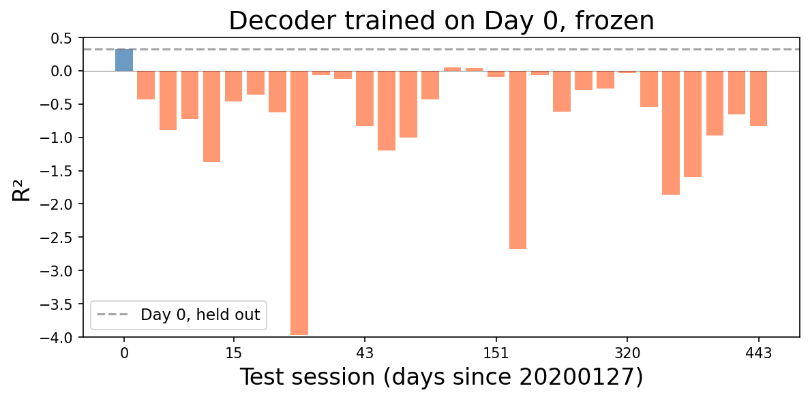
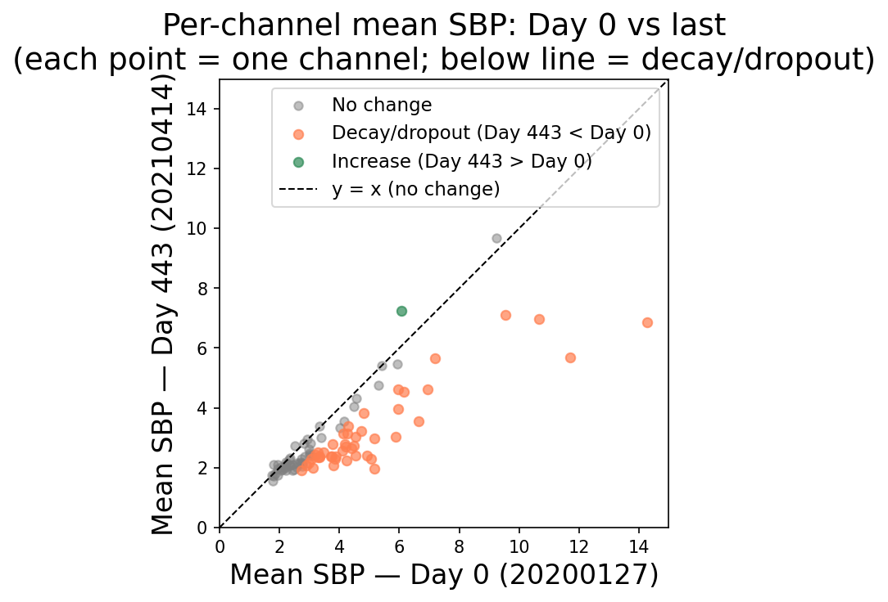

# How badly does a decoder trained on Day 0 fail on later days, and what changes in the signal?

**Status:** Answered · decoder spec `v2` · commit `b83880b` · 2026-10-26

**Short answer: badly, from the first later session on.** A decoder trained on Day 0 scores R² 0.323 on held-out Day-0 data. On later sessions it does worse than predicting the average movement on 27 of 29; its median R² over those sessions is −0.619 (95 % CI −0.834 to −0.359), below zero. The first later session (day 3) is already at −0.432. The signal it reads has moved: per channel, the average spike-band power on the last session differs from Day 0, mostly downwards, and by different amounts on different channels, so the Day-0 weights no longer match.

Details

| Quantity | Value |
| --- | --- |
| Day-0 decoder, Day 0 held out | 0.323 (median of seed 0 0.324 · seed 1 0.323 · seed 2 0.322; unshifted grid 0.323) |
| Later sessions with R² < 0 | 27 of 29; share 93 % (95 % CI 83 % to 100 %) |
| Median R², later sessions | −0.619 (95 % CI −0.834 to −0.359) |
| First later session | −0.432 on day 3 (2020-01-30) |
| Lowest | −3.970 on day 29 (2020-02-25) |
| Last session | −0.831 on day 443 (2021-04-14) |
| By gap, 1–7 days | −0.432 (one session) |
| By gap, 8–30 days | median −0.729 (95 % CI −1.371 to −0.458), 7 sessions |
| By gap, over 30 days | median −0.545 (95 % CI −0.834 to −0.124), 21 sessions |

- **Data:** 30 LINK sessions, 2020-01-27 → 2021-04-14 (443 days), index-finger velocity; Day 0 is the first recorded session, about day 349 after implant. Raw spike-band power, no normalisation.
- **Decoder:** ridge on spike-band power over the last 100 ms, predicting velocity at the current bin (spec `v2`); fit once on all of Day 0 and frozen. Day 0 itself is scored on 5 held-out blocks; seeds shift where the blocks start. The first 6 s of each session are never scored.
- **Uncertainty:** 95 % CIs from 2,000 session-resampled draws over the later sessions. Later-session scores do not depend on the seed (one fit, whole sessions).
- **Limits:** one animal, one task, one calibration day (every calibration day against every later one is in the drift-fix report and the scoreboard); recording period and gap are partly confounded; the channel figure compares two sessions only and is not a test of which channels drift most.
- **Cost:** 21 decoder fits, 12 s; the decoder costs 576 multiply-accumulates per 20 ms bin.

*Generated by `analyses/day0_decay.py` from `results/analyses/day0_decay.json`. Do not edit by hand.*
