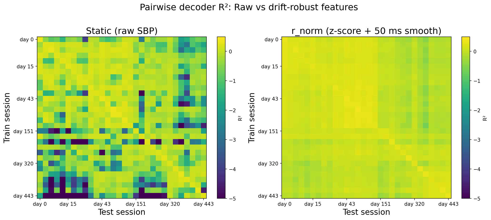

# Does per-session normalisation stop a decoder trained on one day from failing on another?

**Status:** Answered · decoder spec `v2` · commit `ed826af` · 2026-10-26

**Short answer: partly.** Z-scoring each session's channels removes the large failures of a frozen decoder: mean cross-day R² goes from −0.907 (95 % CI −1.381 to −0.524) on raw spike-band power to +0.030 (95 % CI −0.012 to +0.079) with `r_norm`. The gain, +0.937 (95 % CI +0.576 to +1.399), is real; the level it reaches is not distinguishable from zero. The 50 ms smoothing step **lowers** transfer: −0.021 (95 % CI −0.028 to −0.014). Beyond a month, a decoder trained on Day 0 scores −0.041 (95 % CI −0.122 to +0.037), indistinguishable from zero: no useful transfer.

Details

| Quantity | Value |
| --- | --- |
| Mean cross-session R², raw SBP | −0.907 (95 % CI −1.381 to −0.524) |
| Mean cross-session R², z-score only | +0.051 (95 % CI +0.014 to +0.095) |
| Mean cross-session R², `r_norm` | +0.030 (95 % CI −0.012 to +0.079) |
| `r_norm` − raw | +0.937 (95 % CI +0.576 to +1.399) |
| Smoothing (`r_norm` − z-score only) | −0.021 (95 % CI −0.028 to −0.014) |
| Day-0 decoder on `r_norm`, same day (held out) | 0.341 |
| Same, 1–7 days later | +0.166 on day 3 (one session) |
| Same, ≥ 30 days later | −0.041 (95 % CI −0.122 to +0.037), 21 sessions |
| Later sessions below zero, Day-0 decoder | raw 27 of 29 · `r_norm` 13 of 29 (first on 2020-06-26) |

- **Data:** 30 LINK sessions, 2020-01-27 → 2021-04-14 (443 days), index-finger velocity; Day 0 is the first recorded session.
- **Decoder:** ridge on spike-band power over the last 100 ms, predicting velocity at the current bin (spec `v2`); trained on one whole session, tested on another; the same-day value is scored on 5 held-out blocks; the first 6 s of each session are never scored.
- **Uncertainty:** 95 % CIs from 2,000 session-resampled draws (pairs share sessions, so sessions are resampled, not pairs). A difference counts only if its CI excludes zero.
- **Limits:** one animal, one task; normalisation uses each session's own statistics (it needs the whole session), so it is a reference, not a deployable method; recording period and gap are partly confounded (most short gaps are in Jan–Mar 2020).
- **Cost:** 540 decoder fits, 233 s; the decoder costs 576 multiply-accumulates per 20 ms bin.

*Generated by `analyses/drift_fix.py` from `results/analyses/drift_fix.json`. Do not edit by hand.*
