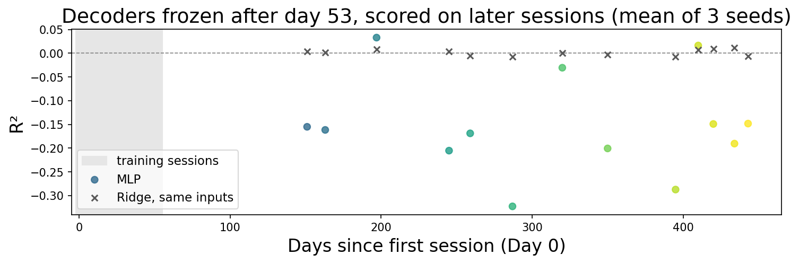

# Does a nonlinear decoder (MLP) transfer to later days better than a linear one, held out?

**Status:** Answered · decoder spec `v2`, MLP `mlp-v2` · commit `f893e82` · 2026-10-26

**Short answer: no.** Trained on the first 17 sessions (days 0–53) and frozen, the MLP scores −0.152 (95 % CI −0.204 to −0.094) on the 13 later sessions (days 151–443), worse than Ridge on the same inputs: −0.153 (95 % CI −0.204 to −0.097). It does no better than predicting the average movement on 11–13 of 13 later sessions, depending on the seed. Scored on sessions it was trained on, the same model gets +0.141 (95 % CI +0.097 to +0.183): the old protocol inflated it by +0.292 (95 % CI +0.234 to +0.349). Its inputs are the bottleneck: Ridge on the same 5 principal components reaches only 0.010 even on the training sessions, against 0.280 for Ridge on the full features.

Details

| Quantity | Value |
| --- | --- |
| Forward split: train | 17 sessions, 2020-01-27 → 2020-03-20 (days 0–53) |
| Forward split: test | 13 sessions, 2020-06-26 → 2021-04-14 (days 151–443) |
| MLP, held out (seeds) | −0.152 (95 % CI −0.204 to −0.094) (−0.158 · −0.129 · −0.167) |
| Ridge, same inputs, held out | +0.001 (95 % CI −0.002 to +0.005) |
| Ridge, full spec on `r_norm`, pooled, held out | +0.003 (95 % CI −0.057 to +0.052) |
| MLP − Ridge same inputs | −0.153 (95 % CI −0.204 to −0.097) |
| Later sessions with MLP R² ≤ 0, by seed | 11 · 11 · 13 of 13 |
| MLP on the same sessions, trained on them (seeds) | +0.141 (95 % CI +0.097 to +0.183) (+0.149 · +0.128 · +0.144) |
| In-sample − held out | +0.292 (95 % CI +0.234 to +0.349) |
| Grouped split (5 date groups, each held out once): MLP · Ridge same inputs | +0.009 (95 % CI −0.015 to +0.032) · +0.004 (95 % CI −0.000 to +0.007) |
| Grouped: MLP − Ridge same inputs | +0.005 (95 % CI −0.018 to +0.028): no detectable difference |
| Variance kept by 5 principal components (training fit) | 18.9 % |
| Training sessions: Ridge on the 5 components · Ridge on full features | 0.010 · 0.280 |

- **Model:** spike-band power (`r_norm`) and threshold-crossing z-scores per channel (192 inputs), compressed by PCA fit on the training sessions only to 5 components, 400 ms of history; MLP with layers of 128 and 64 units, fast movements weighted ×4, early stopping on 10 % of training rows. Ridge is fit on exactly the same rows. The first 6 s of each session are never scored.
- **Uncertainty:** per-session R² is averaged over seeds 0–2, then 95 % CIs from 2,000 session-resampled draws over the held-out sessions. A difference counts only if its CI excludes zero.
- **Limits:** one animal, one task; the features are normalised with each session's own statistics, so none of this can run live, and it gets no calibration-free-days score; PCA size and velocity weighting were not re-tuned held out. An MLP on the full inputs without PCA is a separate hypothesis, not tested here.
- **Cost:** inference per 20 ms bin: MLP 22,656 multiply-accumulates, Ridge on the same inputs 1,065, Ridge full spec 576. 21 MLP fits of 39–107 s each; 25 min in all.

*Generated by `analyses/mlp_heldout.py` from `results/analyses/mlp_heldout.json`. Do not edit by hand.*
