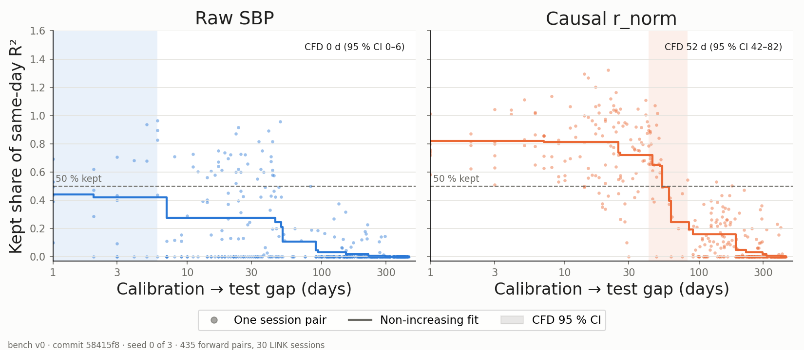

# Lab note 2026-W43 (2) · Our decoder was handicapped, and the cost of causality was not real

**Question:** how close can a device-sized method get to zero recalibration? This week: checking the baseline before building on it.

## EXP-002: does the cross-session MLP decode sessions it never saw?

No. Part 3's MLP was trained and scored on the same 30 sessions. Frozen after day 53 and scored on the 13 sessions from days 151–443, it reaches **R² −0.152** (seeds −0.167 … −0.129), against +0.141 when scored in-sample, and it is below a Ridge decoder given the same inputs by **−0.153** (95 % CI −0.204 to −0.097). Part 3 is rewritten as a negative result.

## EXP-003: is our Ridge baseline as good as the dataset authors'?

It was not. On the LINK paper's own split (first 300 trials train, next 75 test), the authors' ridge scored index-velocity R² 0.246; our decoder 0.181. The cause was a choice made once and never tested: predicting velocity 60 ms ahead of the newest SBP bin. That lead costs about 0.07 R² on any feature that cannot see the future, and the two-sided smoothing in acausal `r_norm` hid most of it.

## EXP-004: pick the window and lag on sessions the result is not reported on

A fixed rule on the 17 earliest sessions picked window 5, **lag 0**. On the 13 later sessions it raised causal same-day R² by **+0.081** (CI +0.067 to +0.097). Decoder spec v2 now matches the authors' ridge (+0.005, CI −0.001 to +0.008).

## Everything re-run on spec v2, with 95 % CIs

| Result | Value [95 % CI] |
| --- | --- |
| CFD, causal `r_norm` | **52 d [42, 82]** (raw SBP 0 d [0, 6]) |
| Same-day R², causal vs acausal | 0.263 vs 0.276 (95 %) |
| Cross-session R², `r_norm` − raw | +0.937 [+0.576, +1.399] |
| 50 ms smoothing (`r_norm` − z-score only) | **−0.021 [−0.028, −0.014]**: it lowers transfer |
| Causal − acausal, cross-session | **+0.019 [+0.011, +0.027]**: causal transfers better |
| `r_norm` Day-0 decoder, 1 month+ | −0.041 [−0.122, +0.037]: no transfer |

Sources: `results/scoreboard.csv` (commit `58415f8`, spec v2) and `results/exp003_cis_v2.csv`. CIs resample sessions, not pairs.

Two published conclusions reverse: the smoothing step hurts, and going causal costs nothing measurable once the decoder stops predicting ahead. Posts 1–3 and the streaming post are re-stated with dated notes.

## What this does not show

- **Gap and recording period are still confounded.** 135 of the 155 pairs 52 days apart or less come from Jan–Mar 2020.
- **One animal, one task.** A second dataset is chosen for the next stage: O'Doherty et al. 2017, raw broadband from a Utah array over 7 months (6 of 30 sessions downloaded).
- **The MLP was not re-tuned** on held-out sessions; its 5-component PCA input carries almost no velocity signal.

## Next

Turn one analysis (the drift fix) into a script that writes its own numbers and report, so prose cannot drift from results again. Then CFD on the full LINK dataset (M1).
