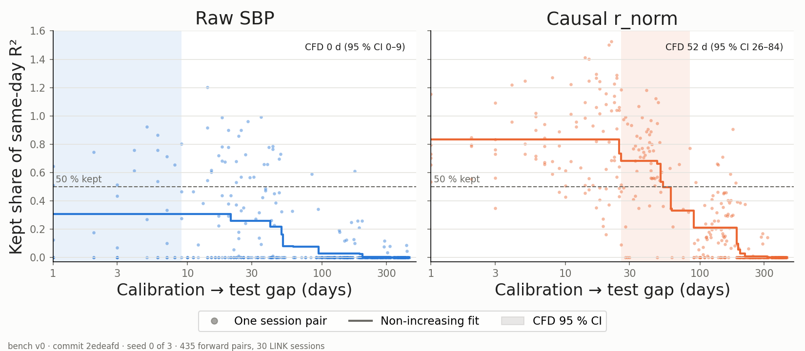

# Lab note 2026-W43 · Day 0 was flattering, and a first calibration-free-days baseline

**Question:** how close can a device-sized method get to zero recalibration? This week: a baseline, not a method.

## EXP-001: is the Day-0 R² 0.299 in-sample?

Yes. The discovery notebook fitted its Day-0 decoder on every Day-0 row, then scored Day 0 on those same rows. Prediction, written before running: held out, R² lands in 0.25–0.29; pass if every fold layout gives ≤ 0.289.

Scored on 5 contiguous held-out blocks of Day 0, with an 8-row gap around each block so no 20 ms bin is shared, the same decoder gets **R² 0.261** (mean of 4 fold layouts 0.2617, SD 0.0008; per-fold range 0.23–0.31). Hypothesis supported. The old figure was 0.038 too high, so the drop to the last session (day 443, R² −0.089) is **0.350, not 0.388**. Parts 1–3 of the drift series are corrected with dated notes; Part 1 also carried numbers from an older run (dates to 2023, R² −10), now fixed.

## First calibration-free days (CFD) baseline

CFD is the longest calibration→test gap at which a frozen, causal decoder keeps ≥ 50 % of its held-out same-day R², read from a non-increasing fit over all 435 forward session pairs.

| Feature | CFD | 95 % CI | Same-day R² | Month+ R² (median) |
| --- | --- | --- | --- | --- |
| Raw SBP | 0 d | 0–9 | 0.173 | −0.272 |
| Causal `r_norm` | **52 d** | **26–84** | 0.183 | −0.039 |

Source: `results/scoreboard.csv`, commit `2edeafd`. Each value is the median over 3 seeds that shift the same-day blocks; all three gave the same CFD. The CI resamples sessions, not pairs, because pairs share sessions.

Per-session normalization that runs online moves CFD from zero to about seven weeks. The decoder costs 576 multiply-accumulates per 20 ms bin, and the normalizer holds 24 bytes per channel in float64, above the 16-byte target.

## What this does not show

- **Gap and recording period are partly confounded.** 135 of the 155 pairs 52 days apart or less, and all 31 within a week, come from Jan–Mar 2020. The CI does not fix that.
- **Offline normalization is not eligible.** Acausal `r_norm` reaches a higher same-day R² (0.270) but needs the whole session, so it gets no CFD. It stays on the scoreboard as a reference.
- **Beyond a month, nothing holds.** The median pair beyond 30 days keeps 0 % for every feature.
- **The MLP results in Part 3 are under re-evaluation**: that decoder was scored on sessions it trained on.

## Next

M1: a CFD baseline to set the target against, then normalizer state carried across sessions (today every session loses its first 6 s to warm-up). The scoreboard now opens with lab health.
