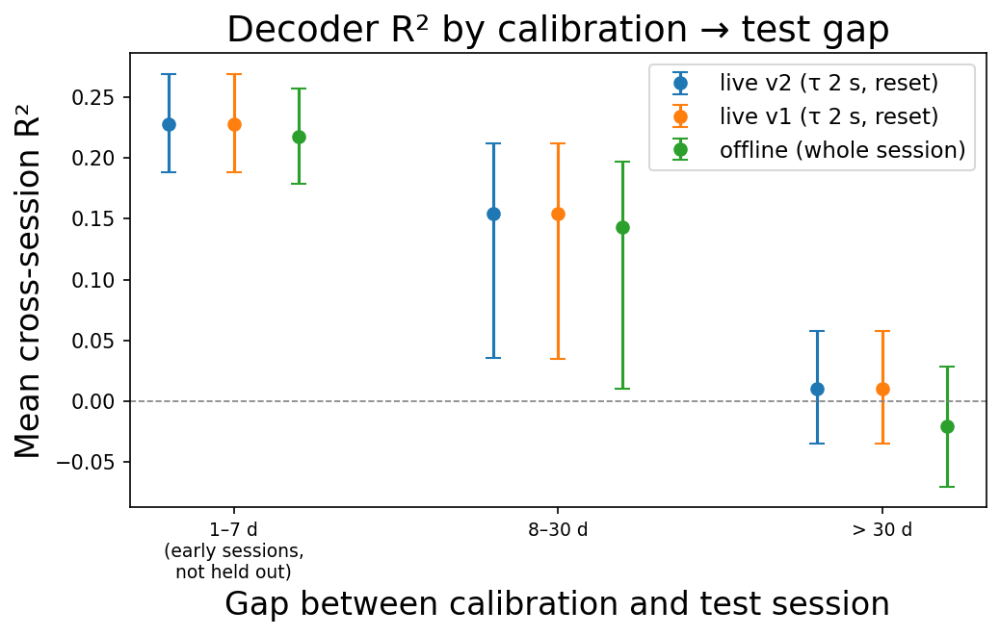

# Lab note 2026-W45 · A slower normaliser does not help, and the integer version loses nothing

**Question:** how close can a device-sized method get to zero recalibration? These two weeks (W44 shipped no note): the normaliser's time constant and its integer form.

## EXP-005: does a slow normaliser that carries state across sessions hold up across days?

No. A fixed rule on the 17 earliest sessions, over τ 2 s to 30 min × reset or carry, kept the live setting: **τ 2 s, reset each session**. Cross-session R² falls with every step up in τ, faster with carry (τ 30 min carry −0.294, τ 2 s reset +0.194). A 2 s normaliser removes each day's baseline shift within seconds; slow statistics carry yesterday's baseline into today.

On the 13 later sessions, live (causal) against offline (acausal) normaliser:

| Result | Value [95 % CI] |
| --- | --- |
| Cross-session R², live − offline, all 156 pairs | **+0.028 [+0.015, +0.040]** |
| … gaps > 30 d (134 pairs) | +0.031 [+0.016, +0.047] |
| … gaps 8–30 d (22 pairs) | +0.011 [−0.013, +0.036] |
| Same-day R², live − offline | −0.014 [−0.020, −0.007] |

The M2 accuracy target (live within 2 % of offline same-day R² in every gap bin) holds at > 30 d and is not shown at 8–30 d, where 22 pairs leave the CI too wide. The later sessions have no 1–7 d gaps to test held out. Bench CFD stays 52 d [42, 82].

## EXP-006: does an int32 fixed-point normaliser lose any accuracy?

No. Against its float64 reference on all 30 sessions:

| Result | Value [95 % CI] |
| --- | --- |
| Feature error over scored bins, max (z) | 8.4 × 10⁻⁴ (output LSB 2.4 × 10⁻⁴), 0 saturations |
| Same-day R², fixed − float | +3.0 × 10⁻⁷ [−1.3 × 10⁻⁷, +7.2 × 10⁻⁷] |
| Cross-session R², fixed − float, 435 pairs | −2.4 × 10⁻⁷ [−1.6 × 10⁻⁶, +1.1 × 10⁻⁶] |
| Bench CFD | 52 d [42, 82] both |
| State per channel | **12 B** (M2 target ≤ 16 B; float64 24 B) |

All seven predictions passed. The fixed-point feature is now a scoreboard row, `r_norm_causal_q` (commit `1554f00`).

**Device cost**, counted by the code as it runs (operations, not cycles): normaliser + decoder at 1024 channels need **45,056 ops** per 20 ms bin with hardware sqrt and divide, under the 10⁵ budget, and 275,456 without. Sqrt and division are 89 % of the normaliser's expanded work: the next thing to cut.

**Also shipped:** four research questions now run as one script each in `analyses/` and write their own reports; the package is split by role, with unchanged bench numbers (`ed826af`).

## What this does not show

- **Gap and recording period are still confounded.** 135 of the 155 pairs 52 days apart or less come from Jan–Mar 2020.
- **One animal, one task.**
- **The decoder is still float64.** Its multiply-accumulates are counted, not converted.

## Next

EXP-007 (pre-registered): track 1/σ with one Newton step per bin, so the int32 normaliser needs no sqrt and no division, within EXP-006's accuracy bounds at ≤ 40 ops per channel. Then CFD on the full LINK dataset (M1).
