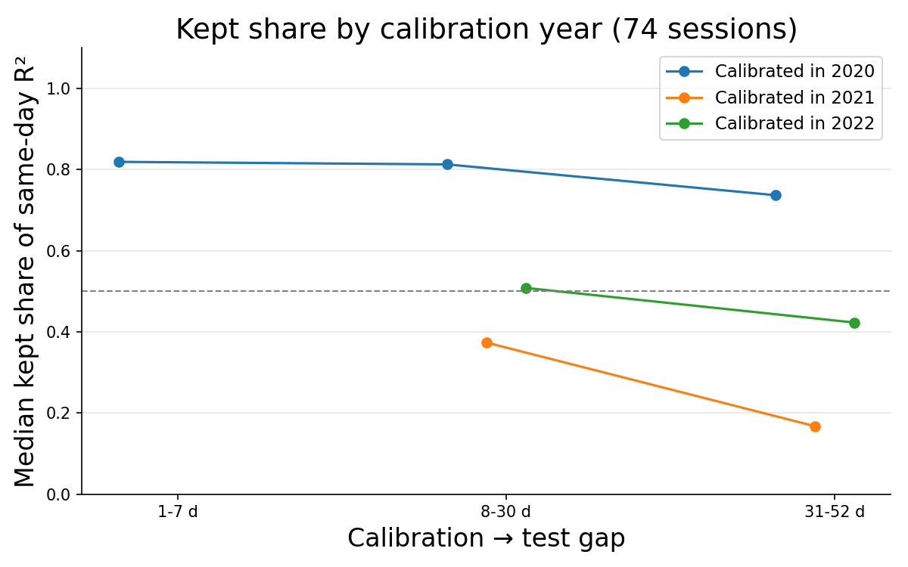

# Lab note 2026-W46 · The 52 days measured the recording period, not the gap

**Question:** how close can a device-sized method get to zero recalibration? This week: is the 52-day CFD of record a property of the gap between sessions, or of when those sessions were recorded? (Shipped three days late.)

## EXP-008 stage 1: does CFD measure the gap, or Jan–Mar 2020?

Mostly the period. On the old 30-session split, 135 of the 155 pairs 52 days apart or less came from Jan–Mar 2020. Adding the other 47 LINK sessions on disk (74 after QC, 2020-01-27 → 2023-06-22, 2,701 forward pairs) moves the north star:

| CFD (frozen decoder keeps ≥ 50 % of same-day R²) | Value [95 % CI] |
| --- | --- |
| Causal `r_norm`, 74 sessions | **25 d [11, 52]** (seeds 25–25) |
| … calibrated in 2021–2023 only (1,326 pairs) | 14 d [0, 24] |
| Fixed-point causal `r_norm_causal_q` | 25 d [11, 52] |
| Raw SBP | 0 d [0, 6] |
| Previous, 30 sessions | 52 d [42, 82] |

At matched gaps, pairs calibrated in 2020 keep far more of their same-day R² than pairs calibrated later:

| Gap | 2020 · 2021 · 2022 (median kept share) | 2020 − 2021–2023 [95 % CI] |
| --- | --- | --- |
| 8–30 d | 0.81 · 0.37 · 0.51 | **+0.39 [+0.07, +0.63]** |
| 31–52 d | 0.74 · 0.17 · 0.42 | **+0.42 [+0.15, +0.72]** |

All four stage 1 predictions passed (CFD < 52 d; contrast ≥ +0.10 with a CI excluding 0 in both bins; raw ≤ 7 d; fixed point = float). By the rule written before the run, that is a **period effect**. The lower share after 2020 is lower cross-day R², not a smaller same-day denominator: same-day R² by calibration year is 0.260 · 0.255 · 0.253 · 0.192 (2020–2023).

**Target style.** Each LINK session uses one of two target styles, CO or RD (39 and 35 sessions here). The bench ignores it. Looked at descriptively: same-style pairs do not keep more than cross-style pairs (8–30 d −0.02 [−0.39, +0.34]), but within one style the 2020 advantage at 8–30 d shrinks to +0.20 [−0.10, +0.56], inconclusive on 35 vs 49 pairs. The pre-registered test of this (P8–P9) runs on the full dataset.

**Also shipped:** the bench scores one session at a time (exact match to the 30-session rows first), a frozen `splits_v1`, and the tooling to fetch the remaining 235 sessions.

## What this does not show

- **The CI still reaches 52 d.** 74 of 312 sessions; stage 2 must halve the CI width to pass (P5).
- **1–7 d is untested outside 2020** (3 pairs); 2023 cells have fewer than 15 pairs.
- **Year is not cause.** Calibration year cannot separate recording period from implant age, and target style is not yet controlled.
- **One animal, one task.**

## Next

EXP-008 stage 2: all 312 LINK sessions, P5–P9, including the within-style test. Then EXP-007 (no sqrt, no division in the int32 normaliser).
