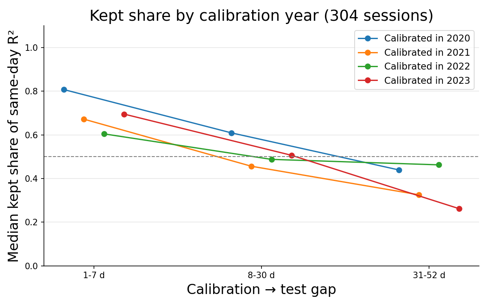

# Lab note 2026-W47 · On 304 sessions CFD is 14 days, and the period effect is inconclusive

**Question:** how close can a device-sized method get to zero recalibration? This week: EXP-008 stage 2. With all 312 LINK sessions, does last week's period effect hold, or does target style explain it?

## EXP-008 stage 2: 304 sessions

QC dropped 8 of 312 sessions, leaving 304 (frozen `splits_v2`, 46,047 forward pairs). Same bench, spec and 3 seeds. Rows: scoreboard `8046449`, code `950ef06`.

| CFD (frozen decoder keeps ≥ 50 % of same-day R²) | 74 sessions | **304 sessions** |
| --- | --- | --- |
| Causal `r_norm` | 25 d [11, 52] | **14 d [9, 20]** (seeds 14–14) |
| … calibrated in 2021–2023 only | 14 d [0, 24] | 14 d [8, 18] |
| Fixed-point `r_norm_causal_q` | 25 d [11, 52] | 14 d [9, 20] |
| Raw SBP | 0 d [0, 6] | 0 d [0, 0] |

Same-day R² is unchanged (median 0.245 vs 0.247); what drops is how long a frozen decoder lasts.

| Gap | 2020 − 2021–2023 [95 % CI] | Same, within one style | Same-style − cross-style |
| --- | --- | --- | --- |
| 1–7 d | +0.16 [−0.05, +0.23] | +0.05 [−0.15, +0.15] | **+0.18 [+0.11, +0.24]** |
| 8–30 d | +0.14 [−0.02, +0.31] | +0.06 [−0.06, +0.21] | **+0.14 [+0.08, +0.20]** |
| 31–52 d | +0.05 [−0.20, +0.28] | +0.01 [−0.23, +0.24] | **+0.12 [+0.03, +0.21]** |

**Predictions (fixed before any v2 data):** P5 pass (CI width 11 d ≤ half of 41 d) · **P6 fail** (1–7 d contrast CI includes 0) · P7 pass · **P8 fail** (no within-style period effect) · **P9 fail** (style contrast ≥ period contrast in every bin).

By the rule written before the run, that is **inconclusive**: not a period effect, and not a pure gap effect either (the CFD CI excludes 52 d). Last week's 2020 advantage shrinks on four times the data, and within one target style it is near zero. The one contrast that clears its CI in every bin is target style: pairs calibrated and tested on the same style keep more of their same-day R².

## What this does not show

- **Style was not the hypothesis.** The style contrast is a pre-registered table, but no prediction said style would win. It needs its own experiment before it becomes a claim.
- **What CO and RD mean is not in the files**; style may stand in for target layout or velocity range.
- **Year is not cause**: recording period and implant age move together.
- **One animal, one task.**

## Next

Proposed: correct last week's "period, not gap" reading on the research page. Pre-register a target-style experiment. Then EXP-007.
